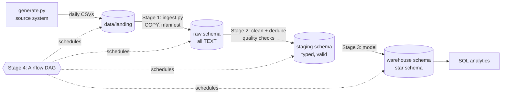

# M-Pesa Sales Pipeline: an end-to-end data engineering project

A batch pipeline that takes daily M-Pesa till exports from 25 (synthetic) Kenyan
shops, lands them in a Postgres warehouse, cleans them, models them into a star
schema, and runs on a schedule with Airflow. It is built one stage at a time,
so each concept can be seen working on its own before the next one is added.



## Roadmap

| Stage | What gets built | Concepts |
|---|---|---|
| **1. Ingest** (done) | Data generator, raw layer, idempotent loader | Landing zone, data contracts, idempotency, atomic loads, lineage, full refresh vs incremental |
| **2. Clean** (done) | `staging` tables, cleaning rules, quality checks graded against the answer key | Type casting, deduplication, normalisation, late-arriving data, quarantine, data quality tests |
| 3. Model | `warehouse` star schema: `fact_transactions` + date/shop/customer dims | Dimensional modelling, surrogate keys, grain, SCD, analytical SQL |
| 4. Orchestrate | Airflow in Docker Compose, a daily DAG | DAGs, task dependencies, retries, backfills, scheduling |
| 5. Harden | End-to-end tests, a dashboard, a write-up | Monitoring, documentation, portfolio presentation |

## Running Stage 1

You need Docker Desktop and [uv](https://docs.astral.sh/uv/) (uv installs Python 3.13 for you if it's missing).

```bash
# 1. Start Postgres and Adminer
cp .env.example .env              # set PG_PORT=5433 here if 5432 is taken
docker compose up -d
docker compose ps                 # wait until postgres shows "healthy"

# 2. Python environment (creates .venv from pyproject.toml + uv.lock)
uv sync

# 3. Run the pipeline
uv run mpesa-pipeline generate     # 30 days of data -> data/landing/
uv run mpesa-pipeline init-db      # create schemas + tables
uv run mpesa-pipeline ingest       # load everything into raw.*
uv run mpesa-pipeline ingest       # run it again: everything is SKIPPED

# 4. Tests
uv run pytest -v
```

`python -m mpesa_pipeline <command>` still works inside an activated `.venv`.
Without uv, `pip install -r requirements.txt` works too.

Then open **http://localhost:8080** (Adminer):
- System: `PostgreSQL`
- Server: `postgres` (the Compose service name; Adminer runs inside Docker)
- Username / password: `de_user` / `de_pass`
- Database: `mpesa_dw`

Open "SQL command" and paste in the queries from `sql/queries/stage1_profile_raw.sql` one at a time.

### Experiments worth trying
1. **Idempotency:** open one CSV in `data/landing/`, delete a few rows, and save. Run `ingest`. Only that file reloads (the log says `RELOAD`), and its row count in `raw.ingestion_log` changes.
2. **Schema drift:** rename the `Amount` header in one file and run `ingest`. That file is rejected, every other file still loads, and the command exits with an error.
3. **Atomicity:** add a broken line such as `X,"unclosed` to the end of a file. Not one row from that file reaches the database.
4. **Lineage:** pick any row in `raw.mpesa_transactions`, then open the file named in `_source_file` at line `_source_row`. It's the same row.

## Running Stage 2

```bash
uv run mpesa-pipeline init-db         # adds the staging tables (safe to re-run)
uv run mpesa-pipeline build-staging   # rebuild staging from raw, then run the quality checks
uv run mpesa-pipeline check           # the quality checks on their own
```

With the default seed (and untouched landing files) the build reports:

```
Staging built: 25 shops, 20416 clean transactions (81 on orphan tills), 42 quarantined
QUARANTINE invalid_amount               42 rows
PASS  01_staging_reconciles_with_raw ... PASS  05_quarantine_rate_within_tolerance
```

That reconciles exactly with `data/generation_report.json`:
20,752 rows written − 209 − 85 duplicates = 20,458 unique receipts = 20,416 clean + 42 quarantined.

How it works:
- **Order:** de-duplicate on `receipt_no` (keep the earliest delivered copy), *then* normalise, *then* validate. Duplicates are exact copies of already-messy rows, so validating first would count a bad row twice.
- **Full rebuild:** `TRUNCATE` + `INSERT … SELECT` in one transaction (`sql/staging/`). Re-running is safe by construction. Incremental merges come in Stage 4.
- **Quarantine, don't delete:** rows that fail a rule go to `staging.mpesa_transactions_quarantine` exactly as they arrived, with a `reasons TEXT[]` listing every rule they broke.
- **Orphan tills are kept**, flagged `is_orphan_till`. The payment is real; only the shop master is missing a row. Dropping them would under-report revenue. Stage 3 maps them to an "Unknown shop" dimension row.
- **Timestamps are plain `TIMESTAMP`** (Nairobi wall-clock time), so the session time zone can't shift them. `DD/MM/YYYY HH:MI` is read day-first and has no seconds (they become `:00`).
- **Checks** (`sql/checks/`) are queries that return the rows breaking a rule. Zero rows means pass. They fail the command if rows go missing, a reversal points nowhere, or a quarantine reason jumps above 2% (a sign the source changed format).

Explore it in Adminer: `SELECT * FROM staging.mpesa_transactions_quarantine;`, then trace any row back with `_source_file` / `_source_row`.

## Project layout

```
mpesa_pipeline/        Python package (each pipeline step is a module)
  config.py            settings from env vars, so it runs anywhere unchanged
  db.py                connections, transactions, migrations
  generate.py          synthetic source system with planted data issues
  ingest.py            Stage 1 loader
  staging.py           Stage 2 runner: builds staging, runs quality checks
sql/                   numbered migrations (run in order by init-db)
  staging/             Stage 2 transforms: raw -> staging (run in order by build-staging)
  checks/              data quality checks: each returns its failing rows
  queries/             analysis / profiling queries
tests/                 pytest; DB tests use a separate mpesa_dw_test database
data/landing/          where source files arrive (git-ignored)
data/generation_report.json   answer key: how many of each issue were planted
```

## The data

`generate.py` imitates a daily till export. The data quality issues below are
planted on purpose, and `data/generation_report.json` counts each one:

| Issue | Example |
|---|---|
| Duplicates (same file and re-sent next day) | the same `Receipt No.` twice |
| Late-arriving rows | a 1 Oct sale in the 2 Oct file |
| Mixed date formats | `2026-10-01 14:03:22`, `01/10/2026 14:03`, `2026-10-01T14:03:22` |
| Formatted amounts | `KES 1,200.00`, `1,200` |
| Phone formats | `254712…`, `+254712…`, `0712…`, `712…` |
| Messy names | `WANJIRU KAMAU`, `  wanjiru kamau `, blank |
| Reversals | negative amount, `Linked Receipt No.` points to the original |
| Orphan tills | till number missing from `shops.csv` |
| Invalid amounts | `0.00` or blank |

The shops, customers and transactions are synthetic. Any resemblance to real
businesses or phone numbers is coincidental.
