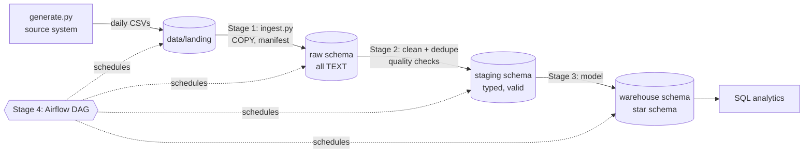

# M-Pesa Sales Pipeline: an end-to-end data engineering project

A batch pipeline that takes daily M-Pesa till exports from 25 (synthetic) Kenyan
shops, lands them in a Postgres warehouse, cleans them, models them into a star
schema, and runs on a schedule with Airflow. It is built one stage at a time,
so each concept can be seen working on its own before the next one is added.



## Roadmap

| Stage | What gets built | Concepts |
|---|---|---|
| **1. Ingest** (done) | Data generator, raw layer, idempotent loader | Landing zone, data contracts, idempotency, atomic loads, lineage, full refresh vs incremental |
| **2. Clean** (done) | `staging` tables, cleaning rules, quality checks graded against the answer key | Type casting, deduplication, normalisation, late-arriving data, quarantine, data quality tests |
| **3. Model** (done) | `warehouse` star schema: `fact_transactions` + date/shop/customer dims | Dimensional modelling, surrogate keys, grain, SCD, analytical SQL |
| **4. Orchestrate** (done) | Airflow in Docker Compose, a daily DAG | DAGs, task dependencies, retries, backfills, scheduling |
| 5. Harden | End-to-end tests, a dashboard, a write-up | Monitoring, documentation, portfolio presentation |

## Running Stage 1

You need Docker Desktop and [uv](https://docs.astral.sh/uv/) (uv installs Python 3.13 for you if it's missing).

```bash
# 1. Start Postgres and Adminer
cp .env.example .env              # set PG_PORT=5433 here if 5432 is taken
docker compose up -d
docker compose ps                 # wait until postgres shows "healthy"

# 2. Python environment (creates .venv from pyproject.toml + uv.lock)
uv sync

# 3. Run the pipeline
uv run mpesa-pipeline generate     # 30 days of data -> data/landing/
uv run mpesa-pipeline init-db      # create schemas + tables
uv run mpesa-pipeline ingest       # load everything into raw.*
uv run mpesa-pipeline ingest       # run it again: everything is SKIPPED

# 4. Tests
uv run pytest -v
```

`python -m mpesa_pipeline <command>` still works inside an activated `.venv`.
Without uv, `pip install -r requirements.txt` works too.

Then open **http://localhost:8080** (Adminer):
- System: `PostgreSQL`
- Server: `postgres` (the Compose service name; Adminer runs inside Docker)
- Username / password: `de_user` / `de_pass`
- Database: `mpesa_dw`

Open "SQL command" and paste in the queries from `sql/queries/stage1_profile_raw.sql` one at a time.

### Experiments worth trying
1. **Idempotency:** open one CSV in `data/landing/`, delete a few rows, and save. Run `ingest`. Only that file reloads (the log says `RELOAD`), and its row count in `raw.ingestion_log` changes.
2. **Schema drift:** rename the `Amount` header in one file and run `ingest`. That file is rejected, every other file still loads, and the command exits with an error.
3. **Atomicity:** add a broken line such as `X,"unclosed` to the end of a file. Not one row from that file reaches the database.
4. **Lineage:** pick any row in `raw.mpesa_transactions`, then open the file named in `_source_file` at line `_source_row`. It's the same row.

## Running Stage 2

```bash
uv run mpesa-pipeline init-db         # adds the staging tables (safe to re-run)
uv run mpesa-pipeline build-staging   # rebuild staging from raw, then run the quality checks
uv run mpesa-pipeline check           # the quality checks on their own
```

With the default seed (and untouched landing files) the build reports:

```
Staging built: 25 shops, 20416 clean transactions (81 on orphan tills), 42 quarantined
QUARANTINE invalid_amount               42 rows
PASS  01_staging_reconciles_with_raw ... PASS  05_quarantine_rate_within_tolerance
```

That reconciles exactly with `data/generation_report.json`:
20,752 rows written − 209 − 85 duplicates = 20,458 unique receipts = 20,416 clean + 42 quarantined.

How it works:
- **Order:** de-duplicate on `receipt_no` (keep the earliest delivered copy), *then* normalise, *then* validate. Duplicates are exact copies of already-messy rows, so validating first would count a bad row twice.
- **Full rebuild:** `TRUNCATE` + `INSERT … SELECT` in one transaction (`sql/staging/`). Re-running is safe by construction. Incremental merges come in Stage 4.
- **Quarantine, don't delete:** rows that fail a rule go to `staging.mpesa_transactions_quarantine` exactly as they arrived, with a `reasons TEXT[]` listing every rule they broke.
- **Orphan tills are kept**, flagged `is_orphan_till`. The payment is real; only the shop master is missing a row. Dropping them would under-report revenue. Stage 3 maps them to an "Unknown shop" dimension row.
- **Timestamps are plain `TIMESTAMP`** (Nairobi wall-clock time), so the session time zone can't shift them. `DD/MM/YYYY HH:MI` is read day-first and has no seconds (they become `:00`).
- **Checks** (`sql/checks/staging/`) are queries that return the rows breaking a rule. Zero rows means pass. They fail the command if rows go missing, a reversal points nowhere, or a quarantine reason jumps above 2% (a sign the source changed format).

Explore it in Adminer: `SELECT * FROM staging.mpesa_transactions_quarantine;`, then trace any row back with `_source_file` / `_source_row`.

## Running Stage 3

```bash
uv run mpesa-pipeline init-db           # adds the warehouse tables (safe to re-run)
uv run mpesa-pipeline build-warehouse   # build the star schema from staging, then run its checks
uv run mpesa-pipeline check             # every layer's checks (or --layer warehouse)
```

Expected with the default seed:

```
Warehouse built: 20416 facts (81 on Unknown shop), 1984 customers, 25 shops (25 versions), 31 dates
```

```
                    dim_date
                       |
     dim_shop ---- fact_transactions ---- dim_customer
```

| Table | Grain (one row per...) | Load pattern |
|---|---|---|
| `fact_transactions` | receipt | Full rebuild from staging, looking up each dimension's surrogate key |
| `dim_date` | calendar day (whole months, sales or not) | Generated; missing days inserted |
| `dim_shop` | version of a shop | **SCD Type 2**: a changed shop gets a new version; old sales keep the old one. Never truncated: the history exists nowhere else |
| `dim_customer` | phone number | **SCD Type 1** upsert: latest name overwrites, keys stay stable |

Orphan-till transactions point at `shop_key = 0`, "Unknown shop", so revenue totals stay complete.
If the shop master later lists that till, the next build moves those facts to the real shop.

Then try the queries in `sql/queries/stage3_analytics.sql`.

### Experiments worth trying
1. **SCD Type 2:** in `data/landing/shops.csv`, change one shop's `Town`. Run `ingest` (only `shops.csv` reloads), `build-staging`, `build-warehouse`. Query 9 in `stage3_analytics.sql` now shows two versions of that shop: the old one closed at the moment the new snapshot was ingested, the new one current. October's sales still report under the old town.
2. **Late-arriving dimension:** pick an orphan till (`SELECT DISTINCT till_number FROM staging.mpesa_transactions WHERE is_orphan_till`), add a row for it to `shops.csv`, and rerun the three commands. Its transactions leave "Unknown shop".
3. **Why INNER JOIN is dangerous:** in `40_fact_transactions.sql`, change `LEFT JOIN warehouse.dim_shop` to `JOIN warehouse.dim_shop` and run `build-warehouse`. The build itself succeeds, but the 81 orphan transactions have silently vanished; only `warehouse/01_fact_reconciles_with_staging` notices and fails the run. Change it back afterwards.

## Running Stage 4

Airflow runs the pipeline once per business day. It needs about 2 GB of the memory Docker Desktop is allowed to use.

```bash
docker compose --profile airflow up -d     # adds Airflow + its own metadata database
```

Open **http://localhost:8081** (no login in this local setup). The `mpesa_daily` DAG starts **paused**.

```
wait_for_file -> ingest -> build_staging -> check_staging -> build_warehouse -> check_warehouse
```

| Task | What it does |
|---|---|
| `wait_for_file` | Sensor: waits up to 6 h for `mpesa_transactions_<day>.csv` to land (checks every minute, without holding a worker slot) |
| `ingest` | Loads only that day's file, plus the shops snapshot |
| `build_staging` / `build_warehouse` | The Stage 2 / Stage 3 builds |
| `check_staging` / `check_warehouse` | Quality gates. A failure stops the run immediately, with no retries, *before* the next layer is touched |

Load the history with a **backfill**. The DAG must be unpaused, because Airflow 3 doesn't run backfill runs for a paused DAG:

```bash
docker exec mpesa_airflow airflow dags unpause mpesa_daily
docker exec mpesa_airflow airflow backfill create --dag-id mpesa_daily \
    --from-date 2026-10-01T00:00:00+03:00 --to-date 2026-10-30T00:00:00+03:00 --max-active-runs 1
```

Give the dates **with the `+03:00` offset**. A bare `2026-10-01` is read as UTC midnight, which is 03:00 in Nairobi, so the backfill would start at the *next* Nairobi midnight and silently skip 1 October.

Unpausing also starts the normal schedule: Airflow creates a run for the latest complete day, whose sensor waits for a file that doesn't exist yet. That's the pipeline doing its job: waiting for today's export. Pause the DAG again when you're done.

Re-running is safe. If the files are already in `raw`, ingest logs `SKIP` and the rebuilds produce identical tables.

Stop Airflow (and free its memory) with `docker compose --profile airflow stop airflow airflow-db`.

### Experiments worth trying
1. **A backfill from empty:** in Adminer run `DROP SCHEMA raw, staging, warehouse CASCADE;`, then `uv run mpesa-pipeline init-db`, then backfill 1-5 Oct. After each run, `SELECT MIN(date_key), MAX(date_key), COUNT(*) FROM warehouse.fact_transactions` grows by a day. Then run `generate`, `ingest`, `build-staging` and `build-warehouse` to get the full month back.
2. **Late data changes "finished" days:** after the 2 Oct run, check 1 Oct's revenue in query 1 of `stage3_analytics.sql`. It went *up*: the 2 Oct file contained late 1 Oct sales. Each run's full rebuild handles this automatically.
3. **A failing quality gate:** damage one day in raw with `UPDATE raw.mpesa_transactions SET amount = '' WHERE _source_file = 'mpesa_transactions_2026-10-05.csv';` (the whole day: enough to push the quarantine rate past the 2% tolerance), then trigger the DAG for 5 Oct (Trigger, with logical date `2026-10-05T00:00:00+03:00`). `check_staging` fails (red), `build_warehouse` never runs ("upstream failed"), and the task log shows the `ALERT` line. The warehouse keeps its last good contents. To undo: `DELETE FROM raw.ingestion_log WHERE file_name = 'mpesa_transactions_2026-10-05.csv';` (the file itself is unchanged, so without this the manifest says "already loaded"), then run `ingest`, `build-staging` and `build-warehouse`.
4. **Retries:** `docker stop mpesa_postgres`, then trigger a run. `ingest` can't connect and goes to `up_for_retry` (yellow), with the next attempt in 1 minute. Run `docker start mpesa_postgres` within that minute and watch the retry succeed. Compare with experiment 3: a broken connection is worth retrying; broken data is not.

DAG tests run inside the container (Airflow isn't installed on the host):

```bash
docker exec mpesa_airflow bash -c "pip install -q pytest && cd /opt/mpesa-pipeline && python -m pytest tests/test_dag.py -p no:cacheprovider"
```

## Project layout

```
mpesa_pipeline/        Python package (each pipeline step is a module)
  config.py            settings from env vars, so it runs anywhere unchanged
  db.py                connections, transactions, migrations
  generate.py          synthetic source system with planted data issues
  ingest.py            Stage 1 loader
  staging.py           Stage 2 runner: builds staging
  warehouse.py         Stage 3 runner: builds the star schema
  checks.py            runs the data quality checks for a layer
sql/                   numbered migrations (run in order by init-db)
  staging/             Stage 2 transforms: raw -> staging (run in order by build-staging)
  warehouse/           Stage 3 transforms: staging -> star schema (run in order by build-warehouse)
  checks/<layer>/      data quality checks: each returns its failing rows
  queries/             analysis / profiling queries
dags/                  Airflow DAG: mpesa_daily.py (Stage 4)
tests/                 pytest; DB tests use a separate mpesa_dw_test database
data/landing/          where source files arrive (git-ignored)
data/generation_report.json   answer key: how many of each issue were planted
```

## The data

`generate.py` imitates a daily till export. The data quality issues below are
planted on purpose, and `data/generation_report.json` counts each one:

| Issue | Example |
|---|---|
| Duplicates (same file and re-sent next day) | the same `Receipt No.` twice |
| Late-arriving rows | a 1 Oct sale in the 2 Oct file |
| Mixed date formats | `2026-10-01 14:03:22`, `01/10/2026 14:03`, `2026-10-01T14:03:22` |
| Formatted amounts | `KES 1,200.00`, `1,200` |
| Phone formats | `254712…`, `+254712…`, `0712…`, `712…` |
| Messy names | `WANJIRU KAMAU`, `  wanjiru kamau `, blank |
| Reversals | negative amount, `Linked Receipt No.` points to the original |
| Orphan tills | till number missing from `shops.csv` |
| Invalid amounts | `0.00` or blank |

The shops, customers and transactions are synthetic. Any resemblance to real
businesses or phone numbers is coincidental.
